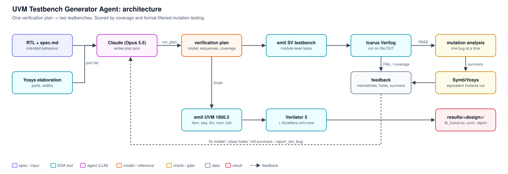
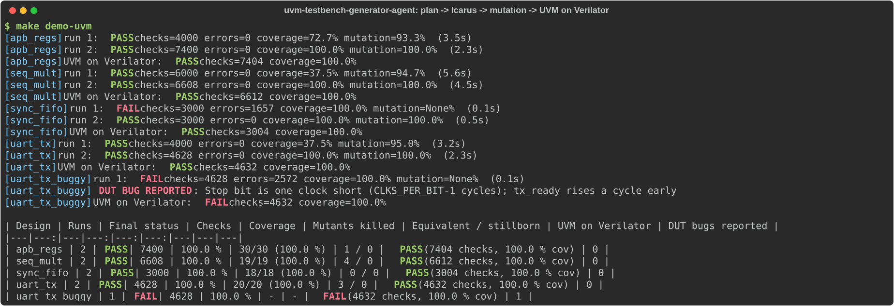
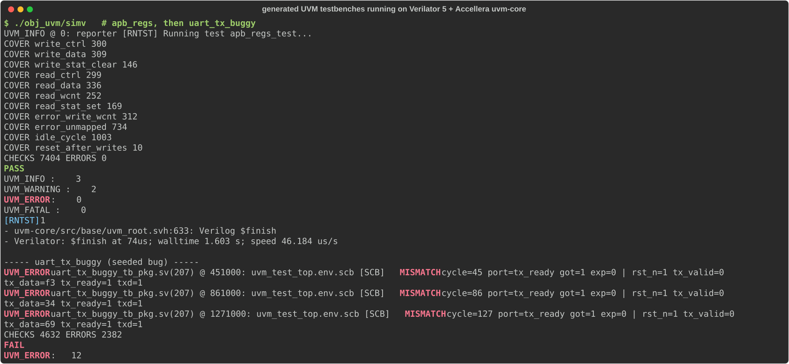
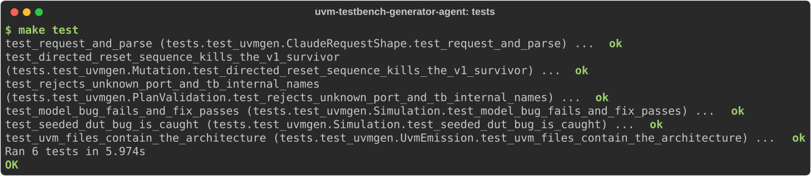

# UVM Testbench Generator Agent

[](https://github.com/Ana2601/uvm-testbench-generator-agent/actions/workflows/ci.yml)

Give it an RTL module and a spec of the intended behaviour. The agent understands both
and writes one **verification plan**: a cycle-accurate reference model, stimulus
sequences and functional coverage. From that plan the tools generate two testbenches:

- a **self-checking SystemVerilog testbench for Icarus Verilog**, which builds in under
  a second, for fast iteration;
- a **real UVM 1800.2 environment**: sequence item, sequences, driver, monitor,
  scoreboard with the same reference model, env and test. CI builds and runs it on
  Verilator 5 against Accellera's `uvm-core`.

Each generated testbench is then scored by **mutation testing**: one injected bug at a
time, with provably equivalent mutants filtered out by formal equivalence.



**The spec is the source of truth.** When the model and the DUT disagree, the agent
decides from the spec which one is wrong. It never bends the model to match the DUT.

## Results

Recorded trajectories, replayed by CI. Every simulation, coverage figure and mutation
score is recomputed, and each UVM testbench is built and run on Verilator
([`results/summary.md`](results/summary.md)).

| Design | What it is | Plan v1 → final | Final checks | Coverage | Mutants killed | UVM on Verilator |
|---|---|---|---:|---:|---:|---|
| `sync_fifo` | FWFT FIFO, valid/ready both sides | **v1 FAIL: the agent's own model was wrong** (spec: no bypass when full) → v2 PASS | 3,000 | 100 % | **18/18** | PASS, 3,004 checks |
| `uart_tx` | 8N1 UART, 4 clk/bit | v1: 37.5 % coverage, 95 % mutation → v2: 100 / 100 | 4,628 | 100 % | **20/20** (+3 equivalent) | PASS, 4,632 checks |
| `apb_regs` | APB3 slave: RW, RO and W1C registers, PSLVERR | v1: 72.7 %, 93.3 % → v2: 100 / 100 | 7,400 | 100 % | **30/30** (+1 equivalent) | PASS, 7,404 checks |
| `seq_mult` | shift-add multiplier, start/busy/done | v1: 37.5 %, 94.7 % → v2: 100 / 100 | 6,608 | 100 % | **19/19** (+4 equivalent) | PASS, 6,612 checks |
| `uart_tx_buggy` | same spec, **seeded off-by-one stop bit** | v1 FAIL → **`report_dut_bug`**: "stop bit is CLKS_PER_BIT-1 clocks" | 4,628 | 100 % | n/a | FAIL (catches it too) |





The feedback loop is the point:

- **Reference model bugs.** The first FIFO model popped first and only then checked
  "not full", so it allowed a write into a full FIFO during a read. The mismatch, read
  against the spec, showed the DUT was right.
- **Coverage holes.** Random stimulus never produced the corner operands, the error
  addresses, the data patterns or a reset mid-frame. The holes drove the directed
  sequences in v2.
- **Mutants that survive 100 % coverage.** In three designs the v1 survivors were
  *reset values* (`txd`, `done`, `CTRL`, `STAT`). They are invisible unless outputs are
  checked during a reset, or registers are read back before they are written.
  Coverage alone would never have shown that.
- **DUT bugs.** On `uart_tx_buggy` the agent quotes the spec clause and reports the bug
  with evidence. It keeps the model unchanged, so the testbench becomes the
  regression test for the fix.



## What gets generated

For each design, under `results/<design>/`:

| File | Contents |
|---|---|
| `plan.json` | What the agent wrote: model (`decls`/`reset`/`outputs`/`step`), sequences, coverage |
| `tb_icarus.sv` | Self-checking testbench, about 140 lines |
| `uvm/<dut>_if.sv` | The interface |
| `uvm/<dut>_tb_pkg.sv` | About 260 lines: item, one `uvm_sequence` per plan sequence plus a reset sequence, driver (drives at negedge), monitor (samples at negedge + 1 ns), scoreboard (the plan's reference model verbatim, compare with don't-care masks, coverage counters), agent, env, test |
| `uvm/tb_top.sv` | Clock, DUT, `uvm_config_db` virtual interface, `run_test` |

The Icarus flavour exists because Icarus 13 cannot run UVM: inside classes it rejects
virtual interfaces, `constraint` blocks and queues. It keeps the UVM *architecture*
(sequences, driver, monitor, scoreboard, coverage) with module-level tasks. Both
flavours run the same model and stimulus code, so the agent iterates in under a second
and ships real UVM.

## How it works

| Path | What it does |
|---|---|
| [`uvmgen/plan.py`](uvmgen/plan.py) | Plan schema and validation (ports, names, code that would not port to UVM) |
| [`uvmgen/rtl.py`](uvmgen/rtl.py) | DUT interface from Yosys elaboration, never from the model's reading of the RTL |
| [`uvmgen/emit_icarus.py`](uvmgen/emit_icarus.py), [`uvmgen/emit_uvm.py`](uvmgen/emit_uvm.py) | The two emitters |
| [`uvmgen/sim.py`](uvmgen/sim.py) | Icarus run; Verilator UVM build (`--binary --timing`, uvm-core, C++ at `-O0`: about 1 min instead of 14) |
| [`uvmgen/mutate.py`](uvmgen/mutate.py), [`uvmgen/lec.py`](uvmgen/lec.py) | Mutant generation. Survivors are classified with a SymbiYosys `abc pdr` equivalence check (free power-up state, spec don't-cares from `designs/<d>/lec.json`, reduced widths for arithmetic) |
| [`uvmgen/agent.py`](uvmgen/agent.py) | The loop and tools: `run_plan`, `report_dut_bug`, `finish` |
| [`skills/uvm-testbench-generation/SKILL.md`](skills/uvm-testbench-generation/SKILL.md) | The agent's skill: spec reading, cycle-based modelling rules (decide handshakes on the pre-edge state), stimulus and coverage planning, how to read each kind of feedback, and the portable SystemVerilog subset |

## Run it

Setup: [OSS CAD Suite](https://github.com/YosysHQ/oss-cad-suite-build), which provides
Icarus, Verilator ≥ 5.020, Yosys and SymbiYosys, plus Python 3.10+.

```bash
make test        # unit tests (~10 s)
make demo        # replay: Icarus testbenches, coverage, mutation analysis (~1 min)
make demo-uvm    # plus build and run every UVM testbench on Verilator (~5 min); fetches uvm-core
make check
```

Live, with Claude (`claude-opus-5-5`, tool use, server-side refusal fallback). Add your
own design under `designs/<name>/` (`rtl/<name>.sv` + `spec.md`):

```bash
pip install -r requirements.txt
export ANTHROPIC_API_KEY=...
make live DESIGN=sync_fifo UVM=1
```

## Honest notes

- **Where the trajectories come from.** They were produced interactively during
  development: Claude wrote each plan after reading the previous run's feedback from
  these tools. CI replays the plans and the bug report, and recomputes everything else.
- **What the mutation score measures.** The operators are single-operator and
  single-constant changes (relational, logical, arithmetic, bitwise, reset values, bit
  selects). That is a standard but limited fault model. 100 % means "no single-operator
  bug escapes", not "no bug escapes".
- **UVM runs without DPI** (`UVM_NO_DPI`). The library prints two warnings about this,
  and there are no other warnings or errors. The coverage model is plain counters,
  because Verilator's covergroup support is incomplete.

## Related work

[AutoBench](https://github.com/AutoBench/AutoBench) and
[CorrectBench](https://arxiv.org/html/2411.08510v1) generate testbenches from a
description and self-correct them. [LLM4Cov](https://arxiv.org/pdf/2602.16953) adds
execution-aware coverage closure. This project adds:

- formal-filtered mutation scoring as the closure signal;
- spec-arbitrated triage between model bugs and DUT bugs;
- output as both a fast SV testbench and a real UVM environment, run on open-source
  simulators.

Part of a hardware portfolio. See also
[rtl-ppa-optimizer-agent](https://github.com/Ana2601/rtl-ppa-optimizer-agent) and
[rtl2gds-agent-team](https://github.com/Ana2601/rtl2gds-agent-team).
